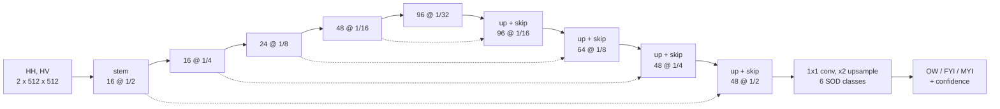

# Skadi — on-board sea-ice segmentation from C-band SAR

Software for the AI payload described in Section 3 of [`Skadi.pdf`](Skadi.pdf): a
convolutional network that turns dual-polarised (HH, HV) SAR imagery into an ice map
with the classes **open water (OW)**, **first-year ice (FYI)** and **multi-year ice
(MYI)**, small enough to run as an INT8 model on the satellite.

The network is trained on Sentinel-1 scenes of the
[AI4Arctic Sea Ice Challenge dataset](https://data.dtu.dk/collections/AI4Arctic_Sea_Ice_Challenge_Dataset/6244065)
and compared with [TinyIceNet](https://arxiv.org/abs/2603.03075), the closest published
work (same dataset, same HH/HV-only input, same FPGA target).

> **Status.** The code is complete and verified end to end on synthetic scenes
> (10 unit tests plus a dry run of the whole chain). **The training on the real
> AI4Arctic scenes has not been run yet**, so this repository contains no accuracy
> numbers for now: `docs/RESULTS.md` and the figures are produced by
> `scripts/run_experiments.py` (see [Reproduce](#reproduce)).

## The model



| | Skadi U-Net | TinyIceNet (baseline) |
|---|---:|---:|
| Encoder | MobileNetV3-Small, ImageNet init | 4 double 3x3 conv blocks |
| Decoder | 4 stages with skip connections, depthwise-separable | one x8 upsampling |
| Parameters | 942.4 k | 146.6 k |
| Multiply-accumulates, 2x512x512 input | 0.91 G | 2.97 G (2.91 G in our count) |
| INT8 size (weights + activations at 8 bit) | 1.27 MB | 0.17 MB |

The six stage-of-development (SOD) classes of the ice charts are predicted and then
grouped: OW = open water, FYI = new + young + thin FYI + thick FYI, MYI = old ice.
Training on six classes keeps the result comparable with the literature and costs
nothing at inference time.

Three input configurations are supported (`--inputs`):

| Name | Channels | Note |
|---|---|---|
| `sar` | HH, HV | the configuration of the Skadi document and of TinyIceNet |
| `sar+ia` | + incidence angle | known on board from the acquisition geometry |
| `sar+geo` | + incidence angle, latitude, longitude, month | known on board from GNSS and clock; **not** comparable with SAR-only results |

## Repository layout

```
skadi/
  preprocess.py   AI4Arctic netCDF scenes -> 512x512 cache
  data.py         in-memory dataset, GPU augmentation (speckle, incidence-angle ramp, geometry)
  models.py       SkadiUNet, TinyIceNet re-implementation, parameter / MAC counters
  losses.py       class-weighted cross-entropy + Dice
  metrics.py      confusion matrix, weighted / macro F1
  train.py        training loop (AdamW, cosine schedule, AMP, EMA)
  evaluate.py     test-set evaluation with the TinyIceNet protocol
  quantize.py     INT8: post-training quantisation and quantisation-aware training
  infer.py        scene -> ice polygons (GeoJSON) with confidence and OOD flag
scripts/
  download_data.py        AI4Arctic train / test download
  run_experiments.py      the whole study with one command
  make_report.py          tables and figures from results/
  make_synthetic_data.py  fake scenes to test the code without the dataset
tests/            unit tests
docs/             report, development notes, generated results
notebooks/        data exploration
```

## Reproduce

Requirements: Python 3.10+, a CUDA GPU (training on CPU works but takes days), about
65 GB of disk for the dataset.

```bash
python -m venv .venv
```

```bash
.venv\Scripts\activate
```

Install PyTorch for your GPU from <https://pytorch.org/get-started/locally/>, then:

```bash
pip install -r requirements.txt
```

```bash
python -m pytest -q
```

Download the data (skip the first command if `data/` already holds the 513 training scenes):

```bash
python scripts/download_data.py
```

```bash
python scripts/download_data.py test
```

Run everything — cache, training of the three main models, evaluation on the 20 test
scenes, INT8 quantisation, tables and figures:

```bash
python scripts/run_experiments.py
```

Add `--ablations` for the ablation runs, `--batch 8` if the GPU runs out of memory,
`--quick` for a two-minute dry run that only checks the installation. The script
skips finished steps, so it can be interrupted and restarted. Outputs:

| Path | Content |
|---|---|
| `results/<run>/log.jsonl` | loss and validation F1 per epoch |
| `results/<run>/test_metrics.json` | test scores, confusion matrix, per-scene F1 |
| `results/<run>/quantization.json` | FP32 / PTQ / QAT comparison |
| `docs/RESULTS.md`, `docs/figures/` | tables and figures |
| `checkpoints/<run>/` | weights (`best.pt`, `int8_scripted.pt`), not versioned |

Single steps can also be run by hand, for example:

```bash
python -m skadi.train --name skadi_sar
```

```bash
python -m skadi.evaluate --name skadi_sar --native-src data/test
```

```bash
python -m skadi.infer --checkpoint checkpoints/skadi_sar/best.pt --scene data/20180808T075536_dmi_prep.nc
```

## How the comparison with TinyIceNet is made

* Same data: AI4Arctic ready-to-train, HH and HV only, each scene resized to 512x512
  (about 800 m per pixel), 513 training scenes and the 20 official test scenes.
* Same metric: F1 over the six SOD classes on all labelled pixels of the test scenes
  (weighted by class support, the AutoICE definition), computed on the resized scenes.
* Two references: the number printed in the paper (75.17 % FP32, 75.22 % with 8-bit
  weights) and our own re-training of the TinyIceNet architecture with exactly the
  same pipeline as our model, which separates the effect of the architecture from the
  effect of the training recipe.
* Model selection uses 30 held-out training scenes; the test scenes are only used for
  the final scores.

## Documentation

* [`docs/REPORT.md`](docs/REPORT.md) — technical report (Italian): method, protocol, design choices.
* [`docs/DEVLOG.md`](docs/DEVLOG.md) — development notes: what was done, in which order, and what went wrong.
* `docs/RESULTS.md` — generated by `scripts/make_report.py` after the experiments.

## Differences from the Skadi document

* The network has 0.94 M parameters instead of the estimated 5 M.
* It predicts six SOD classes and groups them into OW / FYI / MYI.
* Training uses the AI4Arctic charts only; the NIC ice charts are not included.
* Lee filtering and the CFAR iceberg detector (steps 2 and 4 of the on-board
  pipeline) are not implemented; the FPGA deployment of the INT8 model is not part
  of this repository.
